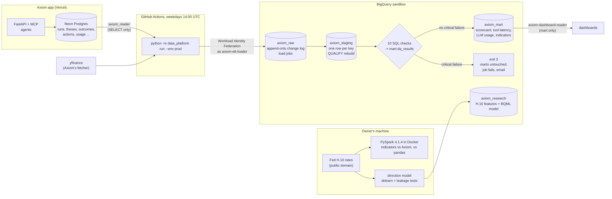

# GCP architecture: Axiom data platform

Built beside the agent app, never inside it. No LLM calls, no prompt or MCP tool changes. Everything runs in the
free BigQuery sandbox (project `axiom-data-514305`, no billing account). Measurements are in
[`RESULTS.md`](../RESULTS.md); access and data rules are in [`gcp-governance.md`](gcp-governance.md).



## The pipeline, step by step

1. **Extract** (`extract.py`, `tables.yaml`). Each table is either *incremental*, re-reading from the newest watermark minus a 1-day look-back, or a full *snapshot* (small tables, and tables that can lose rows). Client IPs in `usage` are cut to their prefix before anything leaves the source.
2. **Load raw.** NDJSON batch load jobs append to `axiom_raw`, with `_wm`, `_loaded_at`, `_source` and `_batch_id` on every row. The sandbox blocks streaming and DML, so there's no INSERT and no MERGE.
3. **Staging.** Each `sql/staging/*.sql` file is rebuilt as a query job with WRITE_TRUNCATE, keeping the newest version per key (`QUALIFY ROW_NUMBER() ... = 1`). The JSON traces in `runs.events_json` are exploded into `tool_calls` and `llm_calls`. Re-runs are idempotent: 0 duplicate keys after repeated loads.
4. **Data-quality gate.** `sql/dq/*.sql` checks keys, accepted values, ranges, references, load and source freshness, and source-vs-warehouse row counts. Results are appended to `mart.dq_results` with the batch id. If a *critical* check fails, the marts are skipped and the run exits 3. A *warning* is only recorded.
5. **Marts.** `sql/mart/*.sql` builds the scorecard (empty below 30 directional calls, like the app), tool-latency percentiles (`APPROX_QUANTILES`), tokens per day with a 7-day moving average (`WINDOW ... RANGE`), and rolling price indicators. The price tables use integer-range partitions on `UNIX_DATE(date)`, clustered by ticker.
6. **Docs.** Each run writes table and column descriptions from the SQL headers and `column_docs.yaml`.

One JSON log line per step (`run_start`, `table_loaded`, `prices_loaded`, `model_built`, `dq_checked`, `run_end`) gives a scheduler's log the start, rows per table, check results and duration.

## Why it looks like this (sandbox constraints, all measured)

| Constraint | Consequence |
|---|---|
| DML (`INSERT`, `MERGE`) and streaming are blocked | Append-only raw plus a deduplicating rebuild of staging |
| 60-day table and partition expiry; longer refused | Integer-range partitions, because date partitions would silently drop old prices (9,000 bars in, 294 kept). Raw history is limited to 60 days. |
| Cloud Run, Cloud Scheduler and Secret Manager can't be enabled without billing | GitHub Actions cron, a GitHub secret, and no staging service |
| No billing account on the project | Nothing can be charged, and there's no budget to alert on. Usage stays under 1 MB scanned per query (dry runs). |

## Side paths (not part of the scheduled run)

- **PySpark** (`data_platform/spark/`): the same indicators written for Spark and checked row for row against Axiom's pandas code. On one machine Spark is slower; the numbers are in `RESULTS.md`.
- **Direction model** (`data_platform/research/`): a time-split logistic regression with baselines, leakage tests and a BigQuery ML twin. It found no practical edge, and it isn't wired into the agents.

## With billing enabled (not done)

These would replace sandbox workarounds. None of them has been run.
- `MERGE` into staging instead of a full rebuild, and native `MONTH` partitions on `date`.
- **Cloud Scheduler** calling a **Cloud Run job**, instead of GitHub Actions.
- **Secret Manager** for the Neon URL, instead of a GitHub secret.
- A **budget alert** on the billing account.
- **A Cloud Run staging service for the API.** It would use the existing `backend/Dockerfile`, which was checked locally: it builds (194 MB image) and `/api/health` answers `ok` on SQLite under a 512 MB, 1-CPU limit (161 MiB used). A sketch of the deploy command:

```
gcloud run deploy axiom-api-staging --source backend --region us-central1 \
  --max-instances 1 --min-instances 0 --timeout 300 --memory 512Mi --cpu 1 \
  --set-secrets DATABASE_URL=axiom-staging-db:latest --no-allow-unauthenticated
```
